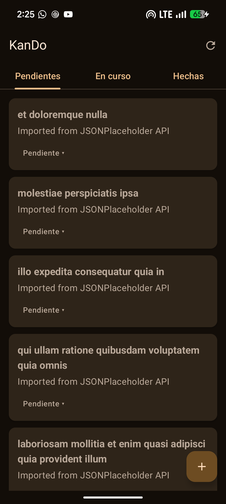
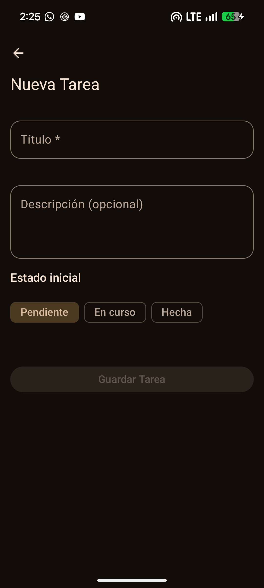

# KanDo - App Móvil de Tareas (Prueba Técnica Android / Kotlin)

KanDo es una aplicación móvil desarrollada en Kotlin y Jetpack Compose como parte de la prueba técnica de desarrollo Android. La app permite gestionar tareas con persistencia local offline (SQLite), sincronización inicial desde una API pública (`JSONPlaceholder`), vista de tablero Kanban con pestañas y paginación, cambio rápido de estado mediante menús desplegables y una arquitectura MVVM robusta desacoplada con Koin.

<p align="center">
  
  
  
</p>

---

## 1. Cómo Ejecutar el Proyecto

1. **Requisitos**:
   - Android Studio (Narwhal / Koala o superior recomendado).
   - JDK 11 o superior.
   - Emulador de Android (API 26+) o dispositivo físico con depuración USB activada.

2. **Pasos**:
   - Clonar o abrir el repositorio en Android Studio.
   - Esperar a que Gradle sincronice las dependencias automáticamente.
   - Seleccionar un dispositivo/emulador en Android Studio.
   - Hacer clic en el botón **Run** (`▶`) o ejecutar en terminal:
     ```bash
     ./gradlew assembleDebug
     ```

3. **Ejecución de Tests**:
   - Para ejecutar los tests unitarios (JVM):
     ```bash
     ./gradlew testDebugUnitTest
     ```
   - Para ejecutar los tests de integración en dispositivo/emulador:
     ```bash
     ./gradlew connectedAndroidTest
     ```

---

## 2. Decisiones Técnicas y Características Principales

- **Lenguaje & UI**: Desarrollado 100% en **Kotlin** y **Jetpack Compose** con Material 3, garantizando una interfaz moderna, reactiva y adaptativa.
- **Arquitectura (MVVM)**: Estructura MVVM limpia y organizada en paquetes:
  - **Model (`model/`)**: Modelos de datos (`Task`, `TaskStatus`).
  - **Data (`data/`)**: Base de datos local SQLite (`TaskDbHelper`) y servicio API REST con **Retrofit + Gson** (`TodoApiService`).
  - **ViewModel (`viewmodel/`)**: `TaskViewModel` que gestiona el estado reactivo (`StateFlow`) y conecta las fuentes de datos con la UI.
  - **View (`view/`)**: Pantallas en Compose (`TaskListScreen`, `CreateTaskScreen`, `TaskDetailScreen`).
- **Inyección de Dependencias (Koin)**: Implementación de **Koin** para la inyección de dependencias (`KanDoApp.kt` y `appModule`), inyectando `TaskDbHelper`, `TodoApiService` y `TaskViewModel` de manera desacoplada.
- **Tablero Kanban con Pager y Tabs**:
  - Uso de `PrimaryTabRow` y `HorizontalPager` para navegar entre los estados de las tareas (*Pendientes*, *En curso*, *Hechas*) deslizando o tocando las pestañas.
- **Selector Rápido de Estado (`DropdownMenu`)**:
  - Las tarjetas de tareas permiten cambiar su estado instantáneamente tocando el distintivo de estado (*Badge*), abriendo un menú desplegable ágil.
- **Top App Bars Colapsables**:
  - Las pantallas de detalle y nueva tarea implementan `MediumTopAppBar` con comportamiento de colapso al hacer scroll (`exitUntilCollapsedScrollBehavior`).
- **Navegación y Botón Atrás del Sistema (`BackHandler`)**:
  - Control de gestos hacia atrás para navegar de regreso a la lista principal en lugar de salir de la aplicación.
- **Persistencia Local (Offline-First)**:
  - Uso de SQLite nativo (`SQLiteOpenHelper`) para almacenamiento offline robusto.
- **Sincronización y Manejo de Errores**:
  - Carga inicial desde [https://jsonplaceholder.typicode.com/todos](https://jsonplaceholder.typicode.com/todos). Mensajes de error y avisos de red completamente localizados en **español** para informar al usuario si trabaja en modo offline.

---

## 3. Qué Haría con Más Tiempo

- **Base de Datos Avanzada**: Migrar a **Room** con migraciones complejas (o SQLDelight) si se requiere tipado reactivo avanzado con Flow.
- **Buscador**: Agregar buscador de tareas a la lista principal.
- **Drag & Drop**: Agregar soporte de arrastrar y soltar a la lista de tareas.
- **Animaciones y Accesibilidad**: Mejorar transiciones entre pantallas y etiquetas de accesibilidad (`contentDescription`).
- **Estados dinamicos**: Capacidad de crear, eliminar y organizar los estados de las tareas.

---

## 4. Uso de la Inteligencia Artificial

- **Qué le pediste**:
  - Estructuración inicial de la arquitectura MVVM y configuración de Koin.
  - Implementación del helper de SQLite, el servicio Retrofit para JSONPlaceholder y los tests unitarios/integración.
  - Redacción del README y soporte para resolver incidencias de compilación y comportamiento de UI en Compose.
- **Qué aceptaste**:
  - La arquitectura MVVM simplificada con Koin para la inyección de dependencias.
  - El diseño del tablero Kanban con pestañas, paginación y menús desplegables para cambio rápido de estado.
- **Qué corregiste / Ajustaste**:
  - Adaptación de la estructura de paquetes a `model`, `data`, `viewmodel` y `view`.
  - Refinamiento de la navegación con `BackHandler` y persistencia de pestañas al regresar de los detalles.
  - Traducción y pulido de los mensajes de error de red al español.
  - Algunos colores o textos salidos de sitio.
